# 🧪 Guia Completo e Roteiro de Testes E2E: Organização em Modo Trial (Plano Inicial)

> [!WARNING]
> ### ⚠️ AVISO CRÍTICO DE ARMAZENAMENTO — MÓDULO DE ENTREGÁVEIS & UPLOADS
> **NÃO SUBMETA FICHEIROS PESADOS OU VÍDEOS BRUTOS (RAW, Apple ProRes, ficheiros > 50 MB - 100 MB) DURANTE OS TESTES.**
> 
> * **Porquê?**
>   1. **Quota de Armazenamento do Trial**: O Plano Inicial possui um teto de **50 GB** alocados (`storage.gb = 50`). Uploads pesados consomem desnecessariamente a quota da organização de teste.
>   2. **Tempo de Processamento & Transcoding**: Ficheiros pesados sobrecarregam a fila de transcodificação de vídeo em background e podem gerar timeouts HTTP no upload pré-assinado.
>   3. **Consumo de Banda & Performance de QA**: O player de revisão web e o Portal do Cliente necessitam apenas de reprodução fluida.
> * **Recomendação Oficial para Testes**:
>   - Utilize **vídeos curtos comprimidos** em formato **MP4 (H.264 / AAC)** com resolução **720p ou 1080p**, entre **5 MB e 25 MB** (clipes de 10 a 30 segundos).
>   - Para testar documentos em anexo (guiões, call sheets), utilize PDFs leves de 1 a 2 páginas (< 2 MB).

---

## 📋 Sumário Executivo do Ambiente de Teste

| Parâmetro | Configuração / Valor no Trial |
| :--- | :--- |
| **Plano Provisionado** | `INICIAL` com estado `TRIALING` (Degustação de 7 dias) |
| **Custo / Pagamento** | **0 AOA** (Não exige cartão, multicaixa nem dados de pagamento) |
| **Limite de Projetos Ativos** | **5 projetos simultâneos** (`projects.max_active: 5`) |
| **Limite de Utilizadores** | **3 membros ativos** (1 OWNER + 2 convidados) (`users.max: 3`) |
| **Limite de Armazenamento** | **50 GB** (`storage.gb: 50`) |
| **Limite de Equipamentos** | **50 itens no inventário** (`equipment.max: 50`) |
| **Portal do Cliente** | **Incluído e Ativo** (`client_portal.enabled: true`) |
| **Créditos Base de IA** | **1.000 créditos** provisionados na conta inicial |
| **Módulos Bloqueados (Paywall Amigável)** | Nora AI (`/ai`), Nora Automate (`/automate`), Nora Insights (`/insights`), Relatórios Avançados |
| **URLs Padrão de Teste** | Frontend: `http://localhost:3000` \| API: `http://localhost:3001` |

---

## 🗺️ Mapa de Execução dos Testes

```mermaid
flowchart TD
    subgraph FASE_1 ["Fase 1: Registo & Acesso"]
        A["1.1 Registo da Produtora"] --> B["1.2 Validação do TrialBanner"]
        B --> C["1.3 Inspeção da Sessão & Dashboard"]
    end

    subgraph FASE_2 ["Fase 2: Governança & Equipa"]
        C --> D["2.1 Perfil & Dados Fiscais da Org"]
        D --> E["2.2 Convite de Membros (Max 3)"]
        E --> F["2.3 Teste de Limite: 4º Membro Bloqueado"]
    end

    subgraph FASE_3 ["Fase 3: Comercial & CRM"]
        F --> G["3.1 Criação de Cliente no CRM"]
        G --> H["3.2 Cadastro de Serviços no Catálogo"]
        H --> I["3.3 Elaboração de Orçamento (IVA 14%)"]
        I --> J["3.4 Aprovação & Conversão em Projeto"]
    end

    subgraph FASE_4 ["Fase 4: Operação & Produção"]
        J --> K["4.1 Gestão do Projeto (Limite 5 Ativos)"]
        K --> L["4.2 Quadro Kanban: 4 Colunas"]
        L --> M["4.3 Equipamentos: Check-out & Check-in"]
        M --> N["4.4 Estúdio: Reserva & Conflito"]
    end

    subgraph FASE_5 ["Fase 5: Entregáveis & Cliente"]
        N --> O["5.1 Upload de Vídeo Leve (MP4 até 25MB)"]
        O --> P["5.2 Player de Revisão: Comentários com Timestamp"]
        P --> Q["5.3 Portal do Cliente: Aprovação Externa"]
    end

    subgraph FASE_6 ["Fase 6: Finanças & Paywall"]
        Q --> R["6.1 Custos Operacionais & Mindgest"]
        R --> S["6.2 Teste de Paywall: AI, Automate & Insights"]
        S --> T["6.3 Painel de Subscrição: Quotas"]
    end
```

---

## 🧪 Roteiro Passo a Passo de Execução

---

### FASE 1: Onboarding, Registo e Provisionamento Atómico do Tenant

#### Cenário 1.1: Registo do Utilizador e da Organização
* **Objetivo**: Validar a criação simultânea de `User`, `Organization`, papel `OWNER`, `Subscription` (`TRIALING`), 4 colunas Kanban e conta de IA.
* **URL**: `/auth/register`

| Passo | Ação | Dados de Entrada | Validação Esperada |
| :---: | :--- | :--- | :--- |
| **1** | Aceder à página de registo | — | Formulário multi-etapas carrega o Passo 1 (Dados Pessoais). |
| **2** | **Teste Negativo**: Palavra-passe fraca | Inserir senha com 8 caracteres (ex: `12345678`) | Barra de força vermelha; botão "Continuar" desabilitado ou erro indicando padrão NIST (mínimo 15 caracteres). |
| **3** | Gerar Senha Válida | Clicar em *"Gerar palavra-passe forte"* ou digitar `NoraTrial2026!#Secure` | Barra de força preenchida a verde; toast de confirmação. |
| **4** | Preencher Dados Pessoais | **Nome**: `Alexandre Gestor Trial` **Email**: `trial-org-[timestamp]@nora-audiovisual.com` | Campos validados sem erros. |
| **5** | Avançar para o Passo 2 | Clicar em **"Continuar"** | Transição suave para o Passo 2 (Dados da Produtora). |
| **6** | Preencher Dados da Produtora | **Nome da Produtora**: `Kalandula Filmes Lda` **Slug**: `kalandula-filmes` **NIF Angolano**: `5417082910` (10 dígitos válidos) | O slug sanitiza caracteres especiais e espaços automaticamente. |
| **7** | Aceitar Termos e Submeter | Marcar *"Aceito os Termos e Políticas"* e clicar em **"Criar Organização"** | 1. Requisição POST responde HTTP 201 Created. 2. Cookie/Token de sessão emitido imediatamente. 3. Modal de boas-vindas exibido. 4. Redirecionamento automático para `/dashboard`. |

#### Cenário 1.2: Verificação do Banner de Trial e Estado Inicial
* **URL**: `/dashboard`
1. **Verificação do Banner**: No topo do ecrã, verificar o componente `TrialBanner`:
   - Mensagem: *"Plano Inicial (Teste): 7 dias restantes (5 projectos, 3 membros, 50 GB)"*.
   - Botão *"Fazer Upgrade"* visível à direita.
2. **Verificação de Dados Provisionados**:
   - Menu lateral com atalhos funcionais para Projetos, CRM, Orçamentos, Equipamentos, Estúdios e Entregáveis.
   - Nome da produtora `Kalandula Filmes Lda` visível no switcher de organização.

---

### FASE 2: Configurações, Segurança e Limite de Equipa (Max 3)

#### Cenário 2.1: Definições da Organização e Trilha de Auditoria
* **URL**: `/settings` (Separador **Organização**)
1. Verificar os campos preenchidos: Nome, Slug e NIF.
2. Adicionar telefone `+244 923 000 111` e morada `Luanda, Angola`. Clicar em **Guardar**.
3. Aceder ao separador **Auditoria** (`/settings` -> Auditoria):
   - Confirmar a existência de registos com timestamps precisos: `ORGANIZATION_REGISTERED` e `PROFILE_UPDATED`.

#### Cenário 2.2: Teste do Limite de 3 Membros na Equipa (Boundary Testing)
* **URL**: `/settings` (Separador **Equipa**)
* **Regra**: O Plano Inicial permite no máximo **3 utilizadores ativos** (1 Proprietário + 2 membros convidados).

| Etapa | Ação | Dados | Resultado Esperado |
| :---: | :--- | :--- | :--- |
| **1** | Visualizar Membro 1 | — | `Alexandre Gestor Trial` listado como `OWNER` (1/3 utilizadores). |
| **2** | Convidar Membro 2 | Email: `produtor.carlos@nora-audiovisual.com` Papel: `PRODUCER` | Convite enviado com sucesso; indicador passa para 2/3. |
| **3** | Convidar Membro 3 | Email: `tecnico.david@nora-audiovisual.com` Papel: `CREW` | Convite enviado com sucesso; indicador passa para 3/3. |
| **4** | **Boundary Test (Tentativa 4º)** | Email: `editor.luis@nora-audiovisual.com` Papel: `CREW` | **Bloqueio de Quota**: O sistema impede o envio e apresenta aviso claro: *"Limite de 3 utilizadores do Plano Inicial atingido. Faça upgrade para adicionar mais colaboradores."* |

---

### FASE 3: CRM, Catálogo de Serviços e Orçamentação Comercial

#### Cenário 3.1: Cadastro de Cliente no CRM
* **URL**: `/crm`
1. Clicar em **"Novo Cliente"**.
2. Preencher:
   - **Nome da Empresa**: `Unitel Angola Telecom`
   - **NIF**: `5403021980`
   - **Email de Contacto**: `marketing@unitel.ao`
   - **Telefone**: `+244 923 888 777`
   - **Cidade**: `Luanda`
3. Clicar em **Guardar**. Confirmar que o cliente aparece na lista e na barra de pesquisa rápida.

#### Cenário 3.2: Configuração de Catálogo de Serviços
* **URL**: `/services`
1. Adicionar 3 serviços representativos:
   - **Serviço 1**: `Diária de Realizador & Operador de Câmara` — Preço Base: `180.000 AOA` (IVA 14%).
   - **Serviço 2**: `Captação de Som Direto com Lapelas e Boom` — Preço Base: `75.000 AOA` (IVA 14%).
   - **Serviço 3**: `Edição, Montagem e Color Grading (Spot 60s)` — Preço Base: `150.000 AOA` (IVA 14%).
2. Validar que os preços e taxas de IVA são calculados de acordo com o regime fiscal angolano.

#### Cenário 3.3: Criação de Orçamento e Conversão em Projeto
* **URL**: `/budgets` -> `/budgets/new`
1. Selecionar o cliente `Unitel Angola Telecom`.
2. Título da Proposta: `Campanha Publicitária Fibra Óptica 2026`.
3. Adicionar as linhas do catálogo:
   - 2 diárias de câmara (`360.000 AOA`);
   - 2 diárias de áudio (`150.000 AOA`);
   - 1 pacote de edição e montagem (`150.000 AOA`).
4. Verificar o resumo: Subtotal líquido `660.000 AOA` + IVA 14% (`92.400 AOA`) = Total `752.400 AOA`.
5. Guardar como **Rascunho** (`DRAFT`).
6. Alterar estado para **Enviado** (`SENT`) e seguidamente para **Aprovado** (`APPROVED`).
7. Clicar no botão **"Converter em Projeto"**:
   - O sistema cria automaticamente um novo projeto com o escopo e orçamento aprovados.

---

### FASE 4: Execução de Projetos, Limite de Quota (Max 5) e Kanban

#### Cenário 4.1: Execução do Projeto Criado
* **URL**: `/projects`
1. Abrir o projeto convertido: `Campanha Publicitária Fibra Óptica 2026`.
2. Verificar os dados herdados: Cliente, valor orçamentado e status `EM PRODUÇÃO`.
3. Alocar membros da equipa técnica criados na Fase 2.
4. Preencher a Call Sheet: Data de rodagem, morada de locação e hora de chamada (07:30).

#### Cenário 4.2: Teste de Limite de 5 Projetos Ativos (Boundary Testing)
* **Regra**: O Plano Inicial permite no máximo **5 projetos simultâneos ativos**.

| Etapa | Ação | Quantidade Ativa | Resultado Esperado |
| :---: | :--- | :---: | :--- |
| **1** | Projeto convertido do orçamento | 1/5 | Ativo. |
| **2** | Criar Projetos 2, 3, 4 e 5 manualmente | 5/5 | Todos criados com sucesso. Contador de quotas atinge 100%. |
| **3** | **Boundary Test (6º Projeto)** | **6/5** | **Bloqueio de Quota**: O modal de criação recusa a operação com aviso: *"Atingiu o limite de 5 projectos activos do Plano Inicial. Conclua ou arquive um projecto existente ou faça upgrade para o Plano Profissional."* |
| **4** | Concluir 1 Projeto | 4/5 | Marcar o Projeto 2 como `CONCLUÍDO`. O sistema liberta a cota e permite voltar a criar um novo projeto. |

#### Cenário 4.3: Quadro Kanban Operacional com 4 Colunas Pré-provisionadas
* **URL**: `/kanban`
1. Confirmar as 4 colunas padrão geradas no registo:
   - `A Fazer` (TODO)
   - `Em Produção` (IN_PROGRESS)
   - `Revisão Técnica` (REVIEW)
   - `Concluído` (DONE)
2. Criar duas tarefas:
   - Tarefa A: *"Revisão de corte bruto com o Realizador"*.
   - Tarefa B: *"Equalização de voz off do locutor"*.
3. Testar **Drag & Drop**:
   - Mover a Tarefa A de `A Fazer` para `Em Produção`.
   - Mover para `Revisão Técnica`.
4. Fazer refresh à página (F5) e verificar a persistência da posição dos cartões no backend.

---

### FASE 5: Equipamentos Técnicos e Reservas de Estúdio

#### Cenário 5.1: Registo de Equipamento e Fluxo de Check-out/in
* **URL**: `/equipment` (Limite de até 50 itens no Trial)
1. Registar equipamentos:
   - Item 1: `Sony Cinema FX3` (Nº Série: `FX3-9921`)
   - Item 2: `Lente Sony FE 24-70mm f/2.8 GM II`
   - Item 3: `Painel LED Aputure Nova P300c`
2. Criar um Kit de Equipamento: *"Kit Iluminação & Câmara Principal"*.
3. **Executar Check-out**:
   - Selecionar a câmara `Sony Cinema FX3`, associar ao projeto ativo e definir data prevista de devolução.
   - Estado passa a `EM USO / RESERVADO`.
4. **Executar Check-in**:
   - Devolver o item, inspecionar estado técnico (*"Em Perfeito Estado"*).
   - O item regressa ao estado `DISPONÍVEL`.

#### Cenário 5.2: Agendamento de Estúdio e Prevenção de Conflito de Agenda
* **URL**: `/studio`
1. Registar ou selecionar o estúdio: `Estúdio Principal - Fundo Infinito`.
2. Criar uma reserva para amanhã, das **09:00 às 13:00**, vinculada ao projeto da Unitel.
3. **Teste de Conflito de Horário**:
   - Tentar agendar uma segunda reserva no mesmo estúdio para amanhã, das **10:00 às 12:00**.
   - **Resultado Esperado**: O sistema deteta a sobreposição e rejeita o agendamento com aviso de horário indisponível.

---

### FASE 6: Entregáveis de Vídeo, Revisão e Portal do Cliente

> [!WARNING]
> ### RELEMBRE-SE: NÃO CARREGAR FICHEIROS PESADOS (> 50 MB)
> Para os passos seguintes, use um ficheiro MP4 de amostra com **5 MB a 20 MB** de resolução 720p/1080p.

#### Cenário 6.1: Submissão de Entregável e Player de Revisão com Timestamp
* **URL**: `/deliverables`
1. Clicar em **"Novo Entregável"** associado ao projeto `Campanha Publicitária Fibra Óptica 2026`.
2. Preencher:
   - **Título**: `Spot TV 60s - Versão 1 (V1)`.
   - **Ficheiro**: Selecionar um vídeo leve de teste (`amostra-teste-10mb.mp4`).
3. Aguardar a conclusão do upload e confirmação de registo no armazenamento.
4. Abrir o player de revisão:
   - Reproduzir o vídeo.
   - Pausar aos `00:12` e inserir comentário técnico: *"Ajustar nível de áudio da música de fundo"*.
   - Pausar aos `00:24` e inserir comentário: *"Inserir logotipo da Unitel no canto superior direito"*.
5. Verificar se as anotações surgem ancoradas na linha temporal do reprodutor com marcadores clicáveis.
6. Ativar a opção: **"Publicar no Portal do Cliente"**.

#### Cenário 6.2: Validação da Experiência do Cliente Externo no Portal
* **URL**: `/portal/deliverables`
1. Aceder ao Portal do Cliente (como utilizador com papel `CLIENT` ou através da rota de pré-visualização do portal).
2. Verificar que o cliente visualiza o entregável publicado.
3. Testar ação de revisão do cliente:
   - Adicionar uma observação aos `00:30`.
   - Clicar no botão verde **"Aprovar Versão"** (ou marcar como *"Aprovado com Alterações"*).
4. Regressar à vista interna da produtora em `/deliverables`:
   - Confirmar que o estado do entregável foi atualizado em tempo real para `APROVADO PELO CLIENTE`.

---

### FASE 7: Finanças Operacionais e Integração Mindgest

#### Cenário 7.1: Apuramento de Custos Operacionais
* **URL**: `/finance`
1. Lançar despesas reais incorridas na rodagem do projeto:
   - Despesa 1: `Catering e Alimentação da Equipa` — `45.000 AOA`.
   - Despesa 2: `Transporte e Combustível de Gerador` — `30.000 AOA`.
2. Visualizar a margem bruta do projeto:
   - Receita Orçada (`660.000 AOA`) - Custos Reais (`75.000 AOA`) = Lucro Bruto Apurado (`585.000 AOA`).

#### Cenário 7.2: Configuração e Parâmetros Mindgest
* **URL**: `/settings` (Separador **Mindgest**)
1. Visualizar o ecrã de ligação ao software de faturação certificado angolano Mindgest.
2. Confirmar os campos de configuração:
   - Chave de API / Tenant ID do Mindgest;
   - Ambiente de Comunicação (Sandbox / Produção);
   - Série de Faturação e Comunicação à AGT.

---

### FASE 8: Validação dos Feature Gates do Trial (Sem Subscrever)

* **Objetivo**: Garantir que as funcionalidades restritas por design no Plano Inicial exibem ecrãs amigáveis de upgrade (*paywalls* controlados) sem provocar falhas ou erros 500 no sistema.

| Módulo / Rota Testada | Ação Executada | Comportamento Obrigatório do Sistema |
| :--- | :--- | :--- |
| **Nora AI** (`/ai`) | Clicar em *"Gerar Guião com IA"* ou aceder à rota `/ai` | Modal ou ecrã informativo: *"Nora AI faz parte dos planos Profissional/Business ou do Add-on Nora AI. Desbloqueie para gerar guiões e resumos automáticos."* Não debita saldo indevido. |
| **Nora Automate** (`/automate`) | Tentar criar um gatilho de automação | Ecrã de bloqueio elegante informando que o módulo Nora Automate está reservado a planos superiores. |
| **Nora Insights** (`/insights`) | Aceder à rota de Business Intelligence | Ecrã de apresentação das vantagens do Nora Insights com convite a upgrade. |
| **Relatórios Avançados** (`/reports`) | Tentar exportar relatórios analíticos avançados | Bloqueio controlado com aviso de funcionalidade restrita no Plano Inicial. |
| **Subscrições** (`/subscriptions`) | Aceder à gestão de subscrição | 1. Mostra o plano atual como **Plano Inicial (Trial 7 dias)**. 2. Exibe as barras de progresso do consumo real de quotas:    - Projetos: 4/5 ou 5/5    - Membros: 3/3    - Armazenamento: < 1 GB / 50 GB (devido ao uso de ficheiros leves)    - Equipamentos: 3/50 3. Apresenta o catálogo oficial de planos superiores em Kwanzas (`AOA`) com IVA incluído. 4. **ATENÇÃO**: Não efetuar qualquer checkout nem envio de comprovativo de pagamento bancário. |

---

### FASE 9: Simulação de Expiração do Trial (Modo Apenas Leitura)

* **Objetivo**: Garantir que após os 7 dias de avaliação o tenant entra em modo seguro de leitura sem perda de dados.
* **Comportamento Previsto do Sistema**:
  1. O **TrialBanner** passa para vermelho (`urgent / expired`):
     > *"Modo Apenas Leitura: A subscrição da sua organização expirou. Pode consultar todos os seus registos gravados anteriormente, mas novas criações e edições estão bloqueadas até regularizar o plano."*
  2. **Garantia de Integridade dos Dados**:
     - Todos os dados previamente cadastrados (clientes, orçamentos, projetos, entregáveis de vídeo, call sheets e equipamentos) permanecem visíveis para consulta e exportação.
  3. **Bloqueio de Mutação**:
     - Botões de "Novo Projeto", "Novo Cliente" e "Submeter Entregável" ficam desativados ou bloqueados no backend com código de erro `SUBSCRIPTION_EXPIRED` ou `READ_ONLY_MODE`.

---

## 📋 Matriz de Critérios de Aceitação (QA Checklist)

Utilize esta matriz para registar as evidências e o resultado de cada teste:

| ID | Cenário de Teste | Tipo | Resultado Esperado | Evidência / Status |
| :---: | :--- | :---: | :--- | :---: |
| **TC-01** | Registo com senha forte NIST | Segurança | Aceita apenas senhas >= 15 caracteres; gera hash Argon2id seguro. | [ ] PASS / [ ] FAIL |
| **TC-02** | Provisionamento atómico do Tenant | Backend / DB | Cria User, Org, Subscrição TRIALING (7 dias), 4 colunas Kanban e IA. | [ ] PASS / [ ] FAIL |
| **TC-03** | TrialBanner no topo da app | UI / UX | Exibe contagem decrescente correta dos 7 dias e quotas do Plano Inicial. | [ ] PASS / [ ] FAIL |
| **TC-04** | Limite de 3 Membros na Equipa | Boundary | Permite convidar até 3 membros; bloqueia com erro amigável o 4º. | [ ] PASS / [ ] FAIL |
| **TC-05** | Cadastro de Clientes & NIF | CRM / Fiscal | Regista cliente com NIF angolano e contactos validados. | [ ] PASS / [ ] FAIL |
| **TC-06** | Catálogo com IVA de 14% | Finanças | Aplica corretamente 14% de IVA nos serviços audiovisuais. | [ ] PASS / [ ] FAIL |
| **TC-07** | Conversão Orçamento -> Projeto | Fluxo Negócio | Orçamento aprovado gera projeto com valores e cliente associados. | [ ] PASS / [ ] FAIL |
| **TC-08** | Limite de 5 Projetos Ativos | Boundary | Permite 5 projetos simultâneos; rejeita o 6º projeto com aviso de quota. | [ ] PASS / [ ] FAIL |
| **TC-09** | Kanban com Drag & Drop | Interatividade | Permite mover cartões entre as 4 colunas com persistência após F5. | [ ] PASS / [ ] FAIL |
| **TC-10** | Inventário & Check-out/in | Operacional | Rastreia saída de equipamento para projeto e retorno com inspeção. | [ ] PASS / [ ] FAIL |
| **TC-11** | Detecção de Conflito de Estúdio | Regra Negócio | Rejeita agendamentos com sobreposição de horário no mesmo estúdio. | [ ] PASS / [ ] FAIL |
| **TC-12** | **Upload de Vídeo Leve (< 25MB)** | **Storage / QA** | **Upload rápido sem timeout e sem consumir a quota de 50GB do Trial.** | [ ] PASS / [ ] FAIL |
| **TC-13** | Comentários com Timestamp | Player Vídeo | Anotações ficam ancoradas aos segundos/minutos exatos do vídeo. | [ ] PASS / [ ] FAIL |
| **TC-14** | Aprovação no Portal do Cliente | E2E Externo | Cliente acede ao portal e aprova entregável; reflete na produtora. | [ ] PASS / [ ] FAIL |
| **TC-15** | Feature Gates (AI / Automate) | Licenciamento | Módulos avançados bloqueados com tela de upgrade sem causar crash. | [ ] PASS / [ ] FAIL |
| **TC-16** | Modo Apenas Leitura Pós-Trial | Resiliência | Mantém todos os dados intactos para consulta após o término dos 7 dias. | [ ] PASS / [ ] FAIL |
